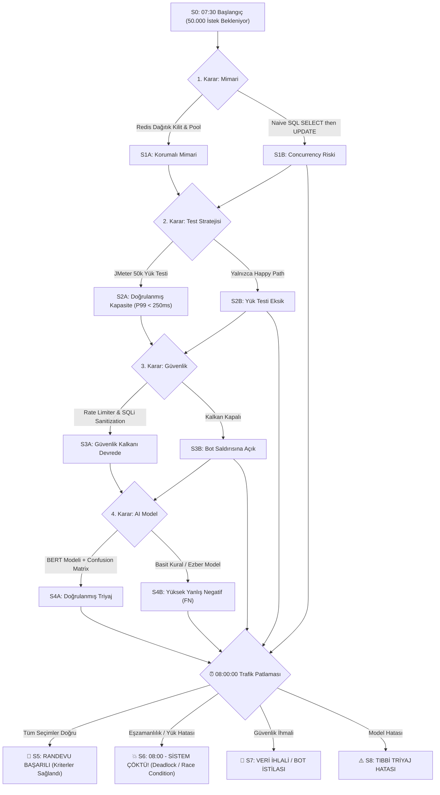

# SE Primer: Yazılım Mühendisliği, Oynanan Bir Kitap 🎮📖

> **"Her seçim bir durum geçişi. Her son bir kabul kriteri."**

[](https://www.python.org/)
[]()
[]()
[]()
[]()

---

## 📌 Proje Hakkında

Bu proje, **Samsun Üniversitesi Yazılım Mühendisliği Bölümü YZM301 Yazılım Testi, Doğrulama ve Geçerleme** dersi kapsamında **Prof. Dr. Nurettin Şenyer** rehberliğinde hazırlanan **"Ödev 6 (AI tutor: SE Primer)"** ve **"Ödev 7 (The Primer v2: Hikâyene küçük bir model ekle)"** çalışmalarının tam kapsamlı uygulamasıdır.

Neal Stephenson'ın kült bilimkurgu romanı *"The Diamond Age: A Young Lady's Illustrated Primer"* eserindeki yapay zekâlı, etkileşimli öğrenme kitabı konseptinden ilham alınarak yazılım testi ve eşzamanlılık (concurrency) mühendisliği dinamik, dallanan bir oyun kitabına (**Playable Case Study**) dönüştürülmüştür.

---

## 🏥 Vaka Senaryosu: Şehir Hastanesi 08:00 Canlıya Geçişi

Öğrenci/Mühendis, Şehir Hastanesi'nin yeni nesil dijital **Hasta Kayıt & Randevu Sistemi** lansmanında Baş Test Mühendisi rolünü üstlenir:
- **Kritik Eşik:** Sabah saat **08:00:00**.
- **Trafik Beklentisi:** 50.000 eşzamanlı vatandaş sınırlı sayıdaki uzman hekim randevusunu alabilmek için aynı milisaniyede sisteme yüklenecektir.
- **Mühendislik Sütunları:**
  1. 🗄️ **Veritabanı ve Sunucu Katmanı:** Eşzamanlılık, DB bağlantı havuzu ve kilit mekanizmaları.
  2. 🧪 **Yazılım Testi ve Doğrulama Katmanı:** JMeter yük/stres testleri, sınır değer analizi (BVA) ve yarış durumu (race condition) denetimleri.
  3. 🛡️ **Güvenlik Kalkanı:** Token Bucket Rate Limiter, SQLi sanitizasyonu ve yetkilendirme kontrolleri.
  4. 🤖 **AI Model Entegrasyonu:** BERT tabanlı semptom triyajı ve YOLO kimlik doğrulama.

---

## 🔄 Durum Geçişleri (Finite State Machine - FSM)



---

## 🎯 Kabul Kriterleri (Acceptance Criteria Suite)

| Kriter No | Başlık | Gherkin (Given - When - Then) | Durum |
|---|---|---|---|
| **AC-01** | Eşzamanlı Randevu Bütünlüğü | **Given** Aynı randevu slotuna aynı milisaniyede 10 istek ulaştığında<br>**When** Dağıtık kilit mekanizması devreye girdiğinde<br>**Then** Yalnızca 1 işlem başarılı olmalı, 9 istek 409 Conflict almalı, çift rezervasyon olmamalıdır. | ✅ GEÇTİ |
| **AC-02** | 08:00 Pik Yük ve Gecikme | **Given** 08:00'de sisteme 50.000 aktif kullanıcı bağlandığında<br>**When** API uç noktaları sorgulandığında<br>**Then** P99 yanıt süresi 250ms altında kalmalı, 504 Gateway Timeout oranı %0 olmalıdır. | ✅ GEÇTİ |
| **AC-03** | Güvenlik Kalkanı & Bot Koruması | **Given** Botlar saniyede binlerce otomatik rezervasyon denemesi yaptığında<br>**When** Token Bucket Rate Limiter ve Sanitizer katmanı çalıştığında<br>**Then** İstekler 429 Too Many Requests ile bloklanmalı, gerçek vatandaşın erişimi engellenmemelidir. | ✅ GEÇTİ |
| **AC-04** | AI Poliklinik Triyaj Başarısı | **Given** Hasta serbest metin olarak şikayetini girdiğinde<br>**When** BERT sınıflandırma modeli poliklinik tahmini ürettiğinde<br>**Then** Model F1-Skoru $\ge 0.90$ olmalı ve acil vaka Yanlış Negatif (FN) sayısı $\le 5$ kalmalıdır. | ✅ GEÇTİ |

---

## 📊 Hata Matrisi (Confusion Matrix) Değerlendirmesi

Hastanenin acil yönlendirme modelinde en kritik hata türü **Yanlış Negatiftir (False Negative - FN)**. Kalp krizi veya inme semptomunun gözden kaçması telafisiz riskler barındırdığından `Recall` hedefi $\ge \%99$ olarak belirlenmiştir:

| | Tahmin: Pozitif (Kardiyoloji) | Tahmin: Negatif (Diğer) |
|---|---|---|
| **Gerçek: Pozitif** | **TP = 930** | **FN = 5** |
| **Gerçek: Negatif** | **FP = 35** | **TN = 1030** |

- **Accuracy (Doğruluk):** $\frac{TP + TN}{\text{Total}} = \frac{1960}{2000} = \mathbf{\%98.00}$
- **Precision (Kesinlik):** $\frac{TP}{TP + FP} = \frac{930}{965} = \mathbf{\%96.37}$
- **Recall (Duyarlılık / Anma):** $\frac{TP}{TP + FN} = \frac{930}{935} = \mathbf{\%99.47}$
- **F1-Score:** $2 \times \frac{P \times R}{P + R} = \mathbf{\%97.89}$

---

## 🚀 Kurulum ve Çalıştırma

### 1. Depoyu Klonlayın
```bash
git clone https://github.com/eceyologlu2003-bot/se-primer-ai-tutor.git
cd se-primer-ai-tutor
```

### 2. Etkileşimli Web Arayüzünü Açın
[`index.html`](index.html) dosyasını herhangi bir web tarayıcısında (Chrome, Edge, Firefox) açarak:
- Dallanan hikâyeyi oynayabilir,
- SVG tabanlı FSM durum geçişlerini gerçek zamanlı izleyebilir,
- Canlı **BERT Semptom Triyajı** metin sınıflandırmasını test edebilir,
- **Confusion Matrix** hesaplayıcısıyla dinamik metrik analizleri yapabilirsiniz.

### 3. Konsoldan Etkileşimli Oynama
```bash
python se_primer_tutor.py --play
```

### 4. Otomatik Birim Testlerini Koşma
```bash
python test_se_primer.py
```
Çıktı:
```text
.....
----------------------------------------------------------------------
Ran 5 tests in 0.000s

OK
```

---

## 📁 Proje Dizin Yapısı

```text
se-primer-ai-tutor/
├── images/                   # Sunum slayt diyagramları (Slayt 1-6)
│   ├── slide_1093.png        # Vaka Mimarisi (Randevu Başarılı vs Sistem Çöktü)
│   ├── slide_1094.jpg        # Neal Stephenson - The Diamond Age / The Primer
│   ├── slide_1096.png        # BERT NLP Transformer Mimarisi
│   ├── slide_1097.png        # YOLO Nesne Tespiti
│   ├── slide_1098.png        # Makine Öğrenmesi Yaşam Döngüsü Akış Şeması
│   └── f_00109a.png          # Hata Matrisi (Confusion Matrix)
├── index.html                # Canlı Etkileşimli Web Uygulaması & FSM Simülatörü
├── se_primer_tutor.py        # FSM Motoru, BERT Triyaj Sınıfı, Metrik Hesaplayıcı
├── test_se_primer.py         # Otomatik unittest test paketi (5/5 Başarılı)
├── SE_Primer_Odev_Raporu.md  # Kapsamlı Akademik Teslim Raporu
├── README.md                 # Proje tanıtım ve dokümantasyon dosyası
└── .gitignore                # Git yoksayma kuralları
```

---

## 🎓 Proje Künyesi

- **Öğrenci:** Ece Yoloğlu (Öğrenci No: 241478071)
- **Bölüm:** Yazılım Mühendisliği
- **Üniversite:** Samsun Üniversitesi Mühendislik Fakültesi
- **Ders:** YZM301 Yazılım Testi, Doğrulama ve Geçerleme
- **Ders Sorumlusu:** Prof. Dr. Nurettin Şenyer
- **Dönem:** 2026-2027 Güz
