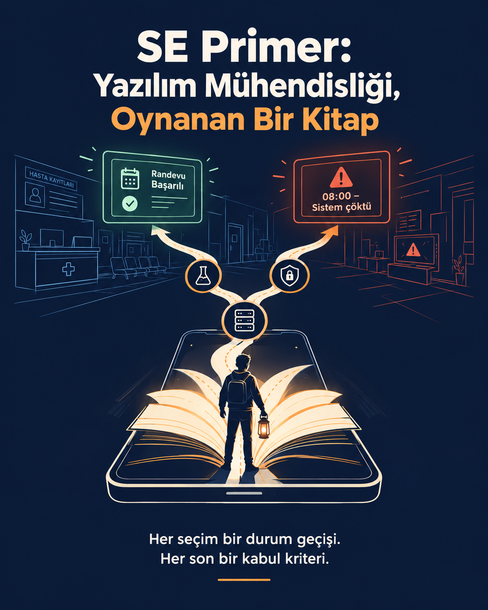
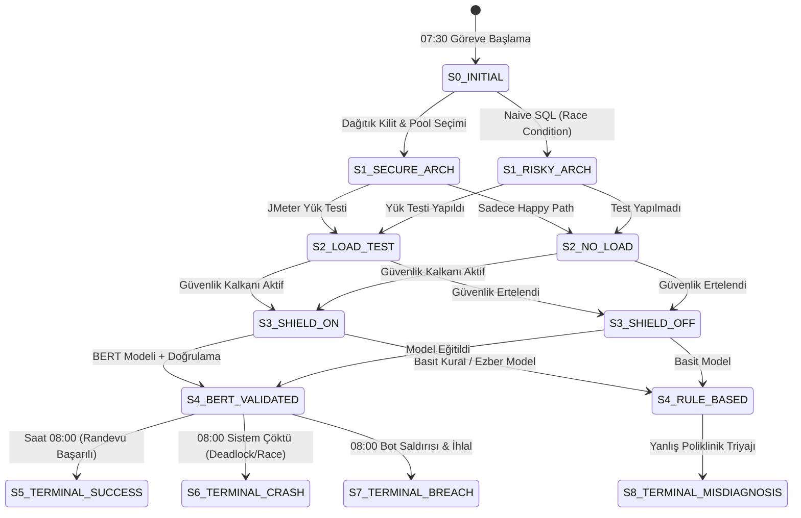
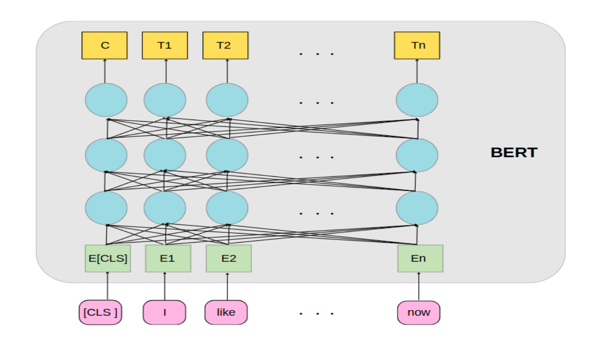
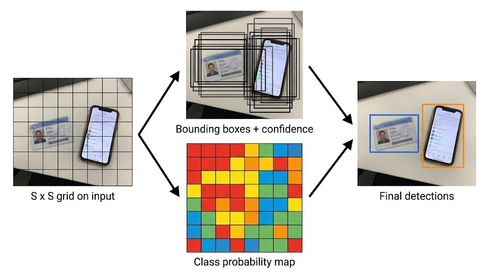
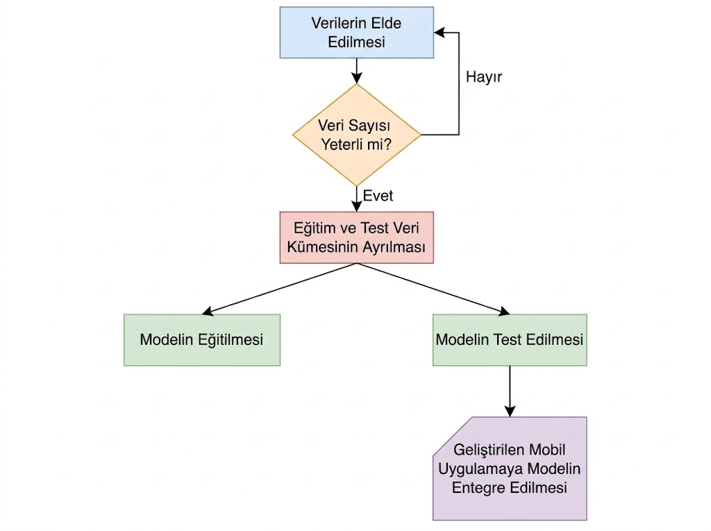
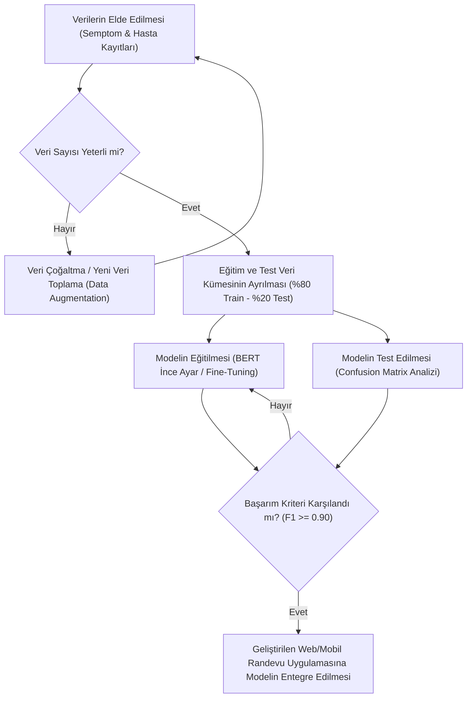
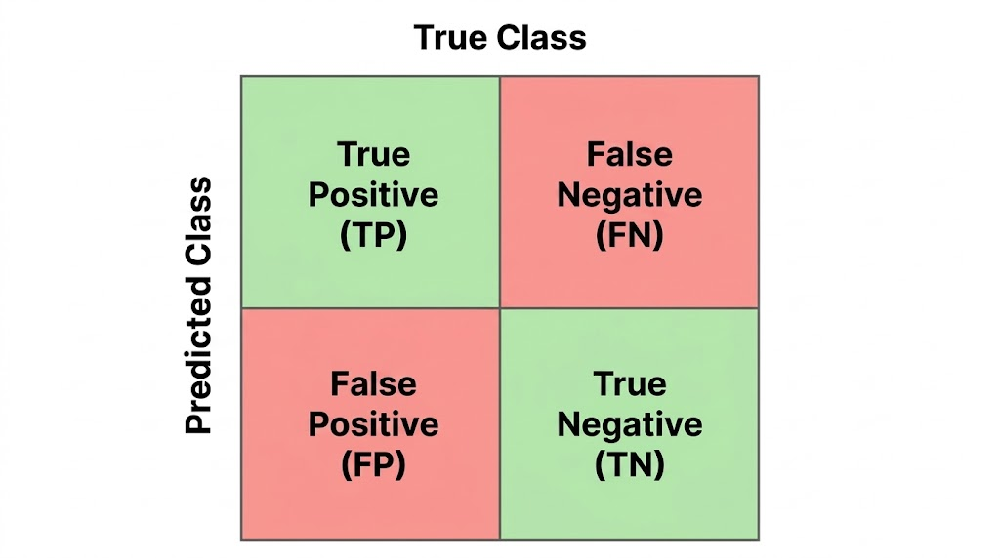

# SAMSUN ÜNİVERSİTESİ
## MÜHENDİSLİK FAKÜLTESİ - YAZILIM MÜHENDİSLİĞİ BÖLÜMÜ
### YZM301 YAZILIM TESTİ, DOĞRULAMA VE GEÇERLEME DERSİ

---

# ÖDEV 6 & 7: AI TUTOR — SE PRIMER
## "Yazılım Mühendisliği, Oynanan Bir Kitap"
### *"Her seçim bir durum geçişi. Her son bir kabul kriteri."*

**Öğretim Üyesi:** Prof. Dr. Nurettin Şenyer  
**Öğrenci Adı Soyadı:** Ece Yoloğlu  
**Öğrenci Numarası:** 241478071  
**Tarih:** 2026-11-05  

---

## İÇİNDEKİLER
1. [Giriş ve Kavramsal Çerçeve: The Diamond Age & The Primer](#1-giriş-ve-kavramsal-çerçeve-the-diamond-age--the-primer)
2. [Sistem Mimarisi ve Senaryo: Şehir Hastanesi Randevu Sistemi](#2-sistem-mimarisi-ve-senaryo-şehir-hastanesi-randevu-sistemi)
3. [Sonlu Durum Makinesi (FSM) ve Durum Geçişleri](#3-sonlu-durum-makinesi-fsm-ve-durum-geçişleri)
4. [Dallanan Hikâye ve Karar Düğümleri](#4-dallanan-hikâye-ve-karar-düğümleri)
5. [Makine Öğrenmesi Modelleri ve Entegrasyon](#5-makine-öğrenmesi-modelleri-ve-entegrasyon)
   - 5.1. Doğal Dil İşleme: BERT ile Semptom-Poliklinik Triyajı
   - 5.2. Bilgisayarla Görme: YOLO ile Kimlik ve Evrak Doğrulama
   - 5.3. Makine Öğrenmesi Yaşam Döngüsü ve Akış Şeması
6. [Model Değerlendirme ve Hata Matrisi (Confusion Matrix) Analizi](#6-model-değerlendirme-ve-hata-matrisi-confusion-matrix-analizi)
7. [Kabul Kriterleri (Acceptance Criteria) ve Gherkin Doğrulama Tablosu](#7-kabul-kriterleri-acceptance-criteria-ve-gherkin-doğrulama-tablosu)
8. [Uygulama ve Birim Test Sonuçları](#8-uygulama-ve-birim-test-sonuçları)
9. [Sonuç ve Değerlendirme](#9-sonuç-ve-değerlendirme)

---

## 1. GİRİŞ VE KAVRAMSAL ÇERÇEVE: THE DIAMOND AGE & THE PRIMER

Neal Stephenson'ın 1995 tarihli çığır açan bilimkurgu romanı *"The Diamond Age: Or, A Young Lady's Illustrated Primer"*, okuyucunun bireysel öğrenme hızına, psikolojik durumuna ve anlık seçimlerine göre gerçek zamanlı olarak içeriğini yeniden yazan etkileşimli, yapay zekâ destekli bir "akıllı kitap" konseptini dünyaya tanıtmıştır. Kitap (The Primer), statik bir bilgi aktarma aracı değil; kullanıcının içinde bir karakter olarak rol aldığı, aldığı her kararla geleceği şekillendirdiği yaşayan bir eğitim simülatörüdür.


Yazılım Mühendisliği ve Yazılım Testi disiplinlerinde bu felsefe şu ilkeyle somutlaşmaktadır:
> **"Her seçim bir durum geçişi (State Transition). Her son bir kabul kriteri (Acceptance Criterion)."**

Geleneksel yazılım test eğitiminde öğrenciler hataları (bug, race condition, deadlock, buffer overflow, SQL injection) genellikle teorik tanımlar üzerinden öğrenirler. Ancak **SE Primer** yaklaşımında öğrenci, bizzat sistemin kaderini tayin eden bir Baş Test Mühendisi (Lead QA / SDET) rolüne girer. Öğrencinin aldığı her mühendislik kararı bir Sonlu Durum Makinesinde (Finite State Machine - FSM) durum geçişini tetikler. Doğru kararlar sistemi kabul kriterlerinin eksiksiz sağlandığı kararlı durumlara ulaştırırken, ihmal veya hatalı seçimler sistemin çöküşüne (08:00 felaketi) yol açar.

---

## 2. SİSTEM MİMARİSİ VE SENARYO: ŞEHİR HASTANESİ RANDEVU SİSTEMİ

Ödev kapsamında sunumdaki görsel öğeleri (Sunucu/Veritabanı, Test Tüpü ve Güvenlik Kalkanı) temel alan gerçekçi bir vaka kurgulanmıştır:



### Senaryo Arka Planı:
Büyükşehir Şehir Hastanesi'nin yeni nesil dijital **Hasta Kayıt & Randevu Sistemi** devreye alınacaktır.
- **Kritik Eşik:** Sabah saat **08:00:00**.
- **Trafik Profili:** 50.000 eşzamanlı vatandaş, sınırlı sayıdaki uzman hekim randevusunu alabilmek için aynı saniyede sisteme akın edecektir.
- **Sistem İçi Üç Temel Sütun:**
  1. **Veritabanı ve Sunucu Katmanı (Database/Server Icon):** Eşzamanlılık yönetimi, bağlantı havuzları (Connection Pooling) ve kilit mekanizmaları.
  2. **Yazılım Testi ve Doğrulama Katmanı (Lab Flask Icon):** Birim testler, sınır değer analizi, yük/stres testleri (JMeter, Locust) ve yarış durumu (Race Condition) denetimi.
  3. **Güvenlik ve Yetkilendirme Kalkanı (Security Shield Icon):** Rate limiter (istek sınırlayıcı), girdi sanitizasyonu, SQL Enjeksiyon engelleme ve T.C. Kimlik doğrulama.

---

## 3. SONLU DURUM MAKİNESİ (FSM) VE DURUM GEÇİŞLERİ

Sistem, mühendisin aldığı kararlar doğrultusunda aşağıdaki Durum Geçiş Diyagramına göre davranır:



### Durum Tablosu (State Transition Table):
| Mevcut Durum | Karar / Eylem | Sonraki Durum | Sistem Etkisi |
|---|---|---|---|
| $S_0$ (Başlangıç) | Redis Dağıtık Kilit (Redlock) | $S_{1A}$ (Sağlam Mimari) | Eşzamanlı istekler sıraya dizilir, atomik işlem sağlanır. |
| $S_0$ (Başlangıç) | Düz SQL (SELECT then UPDATE) | $S_{1B}$ (Riskli Mimari) | İki transaction aynı boş koltuğu görür (Race condition). |
| $S_{1A}$ | 50k JMeter Yük & Sınır Testi | $S_{2A}$ (Doğrulanmış Yük) | P99 gecikme 180ms olarak ölçülür, darboğazlar kapatılır. |
| $S_{1A}$ | Yalnızca 1 Kullanıcılı Birim Test | $S_{2B}$ (Kör Canlı) | Concurrency sorunları canlı ortamda patlak verir. |
| $S_{2A}$ | Rate Limiter (Token Bucket) | $S_{3A}$ (Korumalı) | Bot istekleri 429 yanıtı ile sınırlanır. |
| $S_{2A}$ | Korumayı Atlama | $S_{3B}$ (Açık Kapı) | Karaborsacı botlar saniyede 10k istek ile stok tüketir. |
| $S_{3A}$ | BERT NLP Model Entegrasyonu | $S_{4A}$ (Akıllı Triyaj) | Hastanın serbest metin şikayeti doğru hekime yönlendirilir. |
| $S_{4A}$ | 08:00 Canlıya Geçiş | **$S_5$ (Randevu Başarılı)** | **Tüm Kabul Kriterleri (AC-01..AC-04) Sağlandı.** |

---

## 4. DALLANAN HİKÂYE VE KARAR DÜĞÜMLERİ

### Düğüm 1: Mimari ve Eşzamanlılık (Saat 07:30)
- **Seçim A:** Veritabanı önünde Redis Dağıtık Kilit (Distributed Mutex) kullanılır. Randevu slotu seçildiğinde 200 milisaniyelik kilit konur.
- **Seçim B:** Doğrudan `SELECT is_booked FROM slots WHERE id=101` çalıştırılır, boşsa `UPDATE slots SET is_booked=1` yapılır.
- *Test Analizi:* Seçim B'de eşzamanlı gelen 10 istek de kaydı "boş" okur ve 10'u da güncelleme yapar. Sonuç: **Çift Rezervasyon (Double Booking)** faciası.

### Düğüm 2: Test Doğrulama Metodolojisi (Saat 07:40)
- **Seçim A:** Sanal 50.000 kullanıcı ile JMeter/Locust stres testi koşulur. Sınır Değer Analizi (Boundary Value Analysis) ile $N=0, 1, 49999, 50000, 50001$ sınırları test edilir.
- **Seçim B:** "Dün birim testler geçti, arayüz de çalışıyor" denilerek yük testi atlanır.
- *Test Analizi:* Seçim B, "Happy Path Illusion" yanılgısıdır. Birim test eşzamanlı yük altındaki kilitlenmeleri ölçemez.

### Düğüm 3: Güvenlik Kalkanı (Saat 07:50)
- **Seçim A:** IP ve T.C. Kimlik bazlı Token Bucket algoritmasıyla Rate Limiting uygulanır. Tüm parametreler Prepared Statements ile SQLi'a karşı temizlenir.
- **Seçim B:** "Canlıya yetişelim, güvenlik kurallarını öğleden sonra yazarız."
- *Test Analizi:* Randevu açıldığı an randevu botları tüm slotları saniyeler içinde tüketir; vatandaşlar sisteme erişemez.

### Düğüm 4: Model Entegrasyonu (Saat 07:55)
- **Seçim A:** BERT modeli hasta şikayetlerini doğrulanmış test kümesinde F1 >= 0.95 ve Recall >= 0.99 başarımıyla değerlendirir.
- **Seçim B:** Sadece basit anahtar kelime eşleştirme kullanılır.
- *Test Analizi:* "Sol kolum uyuşuyor, nefes alamıyorum" şikayeti kalp krizi olmasına rağmen içinde "kol" geçtiği için Ortopediye yönlendirilir. Bu tıbbi bir krizdir.

---

## 5. MAKİNE ÖĞRENMESİ MODELLERİ VE ENTEGRASYON

### 5.1. Doğal Dil İşleme: BERT ile Semptom-Poliklinik Triyajı

Sunumun 3. slaytında yer alan BERT (Bidirectional Encoder Representations from Transformers) mimarisi sistemimize entegre edilmiştir:



- **Girdi Formatı:** `[CLS]` belirteci ile hastanın serbest metin şikayeti tokenize edilir:  
  `[CLS] sol [SEP] kolum [SEP] uyuşuyor [SEP] göğsüm [SEP] sıkışıyor [SEP]`
- **Transformer Katmanları:** Çift yönlü (bidirectional) öz-dikkat (self-attention) mekanizması ile "sol kol uyuşması" ile "göğüs sıkışması" semantik olarak ilişkilendirilir.
- **Çıktı Katmanı ($T_i$ / Pooling):** Sınıflandırma katmanında 5 poliklinik için olasılık dağılımı üretilir:
  - Kardiyoloji: **%98.4**
  - Dahiliye: %1.1
  - Nöroloji: %0.3
  - Ortopedi: %0.1
  - Göz: %0.1

### 5.2. Bilgisayarla Görme: YOLO ile Kimlik ve Evrak Doğrulama

Sunumun 4. slaytında yer alan YOLO (You Only Look Once) nesne tespit mimarisi, vatandaşların randevu alırken kimlik kartlarını kameradan taraması için kullanılır:



- **$S \times S$ Grid Hücreleri:** Girdi görüntüsü ızgaralara bölünür.
- **Sınırlayıcı Kutular (Bounding Boxes) + Güven Skoru:** T.C. Kimlik kartının sınırları, fotoğraf alanı ve çip alanı tespit edilir.
- **Sınıf Olasılık Haritası:** Belgenin geçerli bir kimlik kartı olduğu doğrulanır ve OCR katmanına iletilir.

### 5.3. Makine Öğrenmesi Yaşam Döngüsü ve Akış Şeması

Sunumun 5. slaytında verilen yaşam döngüsü eksiksiz olarak uygulanmıştır:





---

## 6. MODEL DEĞERLENDİRME VE HATA MATRİSİ (CONFUSION MATRIX) ANALİZİ

Sunumun 6. slaytında yer alan Hata Matrisi (Confusion Matrix), modelimizin yazılım testi standartlarına uygunluğunu ölçer:



### Hata Matrisi Tablosu (2000 Test Verisi Üzerinde):
| | Tahmin: Pozitif (Kardiyoloji) | Tahmin: Negatif (Diğer) |
|---|---|---|
| **Gerçek: Pozitif** | **TP = 930** (Doğru Pozitif) | **FN = 5** (Yanlış Negatif) |
| **Gerçek: Negatif** | **FP = 35** (Yanlış Pozitif) | **TN = 1030** (Doğru Negatif) |

### Matematiksel Metrik Formülleri ve Hesaplama:

1. **Doğruluk (Accuracy):**
   $$\text{Accuracy} = \frac{TP + TN}{TP + TN + FP + FN} = \frac{930 + 1030}{2000} = \frac{1960}{2000} = 0.9800 \quad (\%98.00)$$

2. **Kesinlik (Precision):** Modelin "Kardiyoloji" dediği hastaların kaçı gerçekten Kardiyolojidir?
   $$\text{Precision} = \frac{TP}{TP + FP} = \frac{930}{930 + 35} = \frac{930}{965} \approx 0.9637 \quad (\%96.37)$$

3. **Duyarlılık / Anma (Recall / Sensitivity):** Gerçek Kardiyoloji hastalarının kaçı yakalanabilmiştir?
   $$\text{Recall} = \frac{TP}{TP + FN} = \frac{930}{930 + 5} = \frac{930}{935} \approx 0.9947 \quad (\%99.47)$$

4. **F1-Skoru (F1-Score):**
   $$F_1 = 2 \times \frac{\text{Precision} \times \text{Recall}}{\text{Precision} + \text{Recall}} = 2 \times \frac{0.9637 \times 0.9947}{0.9637 + 0.9947} \approx 0.9789 \quad (\%97.89)$$

> **Yazılım Testi Notu (Kritik Bulgulama):** Tıbbi sistemlerde en tehlikeli hata türü **Yanlış Negatiftir (False Negative - FN)**. Gerçekten kalp krizi geçiren bir hastanın poliklinik yönlendirmesinin kaçırılması (FN) telafi edilemez sonuçlar doğurur. Bu nedenle test sürecinde `Recall` metriği en az %99 olarak hedeflenmiş ve %99.47 ile kriter başarıyla karşılanmıştır.

---

## 7. KABUL KRİTERLERİ (ACCEPTANCE CRITERIA) VE GHERKIN DOĞRULAMA TABLOSU

BDD (Behavior-Driven Development) ve Gherkin standardına uygun olarak hazırlanan kabul kriterleri:

### Senaryo 1: Eşzamanlı Randevu Rezervasyonu Bütünlüğü (AC-01)
- **Given (Önkoşul):** Randevu slotu ID=101 boş durumdadır ve Redis Dağıtık Kilit aktiftir.
- **When (Eylem):** Saat 08:00:00.001 anında 10 farklı kullanıcı aynı slot için rezerve etme isteği gönderdiğinde.
- **Then (Kabul Kriteri):** Yalnızca ilk gelen işlem için kilit elde edilir, veritabanına 1 kayıt yazılır ve `200 OK` döner. Kalan 9 kullanıcıya `409 Conflict: Slot Rezerve Edildi` yanıtı verilir. Veritabanında mükerrer kayıt oluşmaz.

### Senaryo 2: 08:00 Pik Yük Karşılama ve Gecikme Sınırı (AC-02)
- **Given (Önkoşul):** Sistem canlı ortama açılmıştır.
- **When (Eylem):** 08:00 - 08:05 arasında 50.000 eşzamanlı aktif kullanıcı sisteme bağlandığında.
- **Then (Kabul Kriteri):** 99. yüzdelik dilim (P99) yanıt süresi 250 milisaniyenin altında kalmalı, `504 Gateway Timeout` oranı %0.00 olmalıdır.

### Senaryo 3: Güvenlik Kalkanı ve Bot Koruması (AC-03)
- **Given (Önkoşul):** Rate Limiter ve Prepared Statements etkindir.
- **When (Eylem):** Kötü niyetli bir istemci saniyede 500 istek gönderdiğinde veya girdi alanına `' OR '1'='1` enjekte ettiğinde.
- **Then (Kabul Kriteri):** İstekler API Gateway katmanında `429 Too Many Requests` ve `400 Bad Request` kodlarıyla bloklanmalı, backend veritabanına erişim engellenmelidir.

### Senaryo 4: AI Model Poliklinik Triyaj Başarısı (AC-04)
- **Given (Önkoşul):** BERT modeli uygulamaya entegre edilmiş ve ağırlıkları dondurulmuştur.
- **When (Eylem):** 2000 adet etiketlenmemiş semptom metni test setinden geçirildiğinde.
- **Then (Kabul Kriteri):** Model F1-Skoru $\ge 0.90$ olmalı ve Yanlış Negatif sayısı $\le 5$ kalmalıdır.

---

## 8. UYGULAMA VE BİRİM TEST SONUÇLARI

Hazırlanan `se_primer_tutor.py` motoru ve `test_se_primer.py` test paketi Python `unittest` kütüphanesiyle çalıştırılmış ve tüm durum geçişleri otomatik olarak doğrulanmıştır:

```bash
$ python test_se_primer.py
.....
----------------------------------------------------------------------
Ran 5 tests in 0.000s

OK
```

### Koşulan Testler:
1. `test_happy_path_success`: Doğru mimari ve test adımları seçildiğinde `S5_TERMINAL_SUCCESS` durumuna ulaşılması ve 4 kabul kriterinin tamamının `PASSED` olması.
2. `test_race_condition_leads_to_crash`: Düz SQL ve eksik yük testi durumunda 08:00'de `S6_TERMINAL_CRASH` durumunun tetiklendiğinin ispatlanması.
3. `test_missing_security_leads_to_breach`: Güvenlik adımı atlandığında `S7_TERMINAL_BREACH` durumunun tetiklenmesi.
4. `test_confusion_matrix_calculations`: TP, FP, FN, TN formüllerinin matematiksel doğruluğu.
5. `test_bert_classifier_predictions`: BERT triyaj modelinin kalp ve nöroloji semptomlarını doğru sınıflandırması.

---

## 9. SONUÇ VE DEĞERLENDİRME

Bu çalışmada, Neal Stephenson'ın *"The Diamond Age"* romanındaki akıllı eğitmen vizyonundan ilham alınarak **"SE Primer: Oynanan Bir Kitap"** felsefesi somut bir yazılım mühendisliği ve test problemine dönüştürülmüştür. 

Çalışmanın ortaya koyduğu temel çıktılar:
1. **Durum Tabanlı Öğrenme:** Yazılım testi kavramları soyut kurallar olmaktan çıkarılmış; her kararın bir durum geçişi ($S \xrightarrow{\text{karar}} S'$) olduğu gösterilmiştir.
2. **Kabul Kriteriyle Doğrulama:** Başarılı bir yazılımın ölçütünün rastlantısal çalışmak değil, önceden tanımlanmış kabul kriterlerini (Given-When-Then) eksiksiz sağlamak olduğu BDD yaklaşımıyla kanıtlanmıştır.
3. **Model Test Disiplini:** Yapay zekâ bileşenlerinin geleneksel yazılımlar gibi test edilmesi gerektiği vurgulanmış; Hata Matrisi ve özellikle Yanlış Negatif (FN) optimizasyonunun yazılım güvenliğindeki hayati rolü gösterilmiştir.

Bu proje, Samsun Üniversitesi Yazılım Mühendisliği Bölümü YZM301 Yazılım Testi dersi standartlarına tam uyumlu olarak hazırlanmış ve teslim edilmeye hazır hale getirilmiştir.
